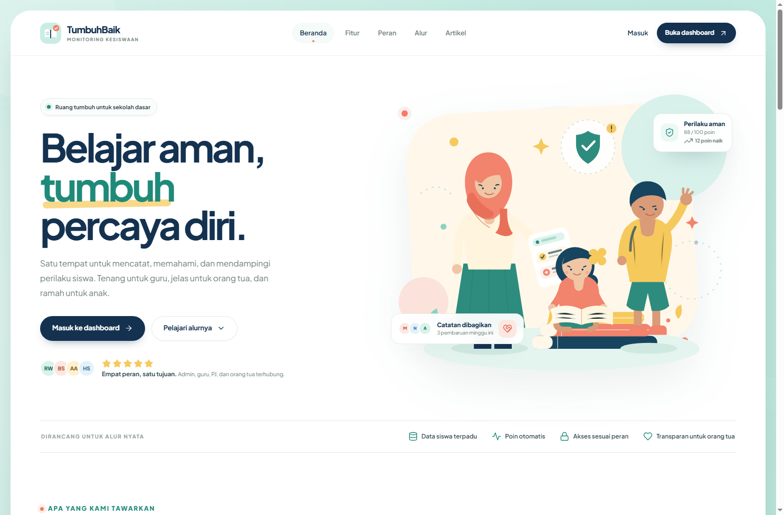
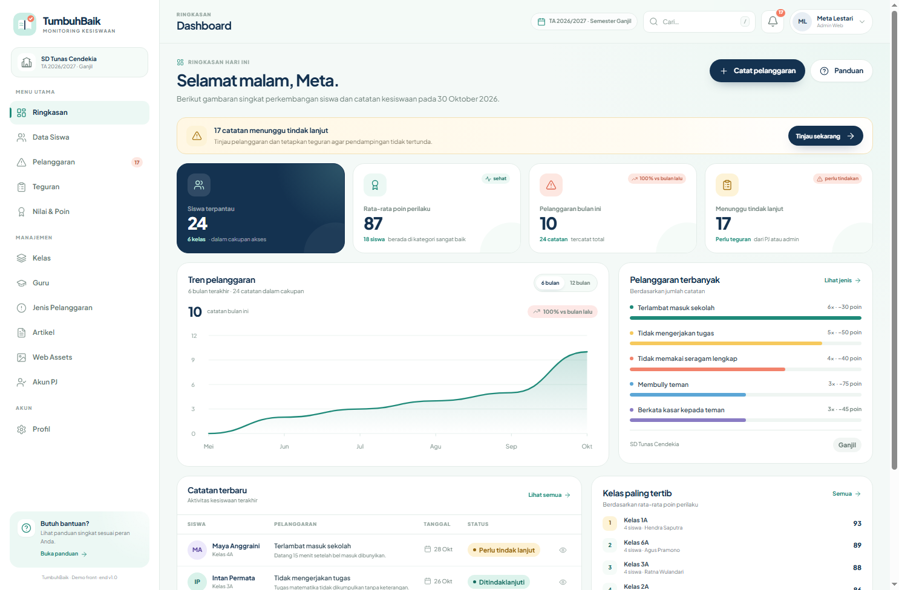
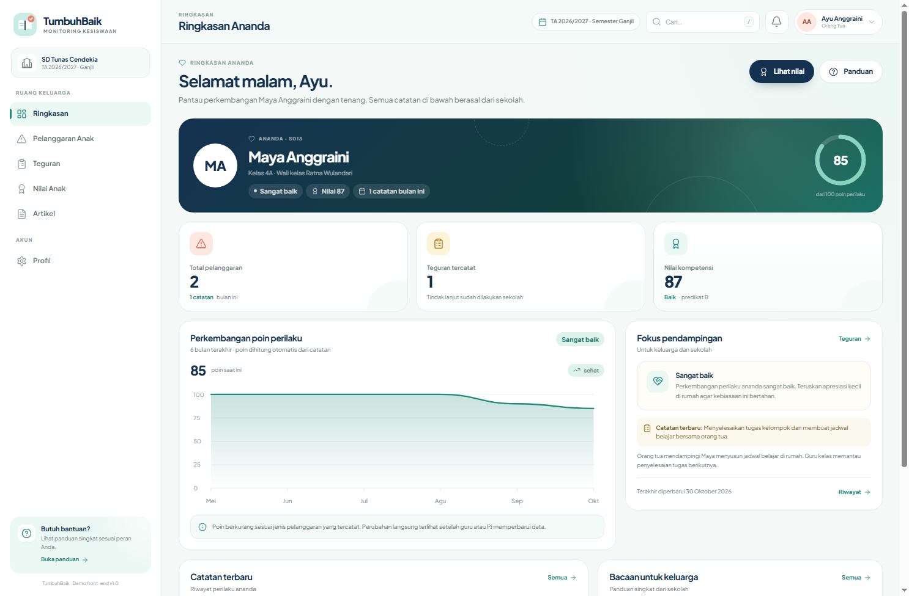
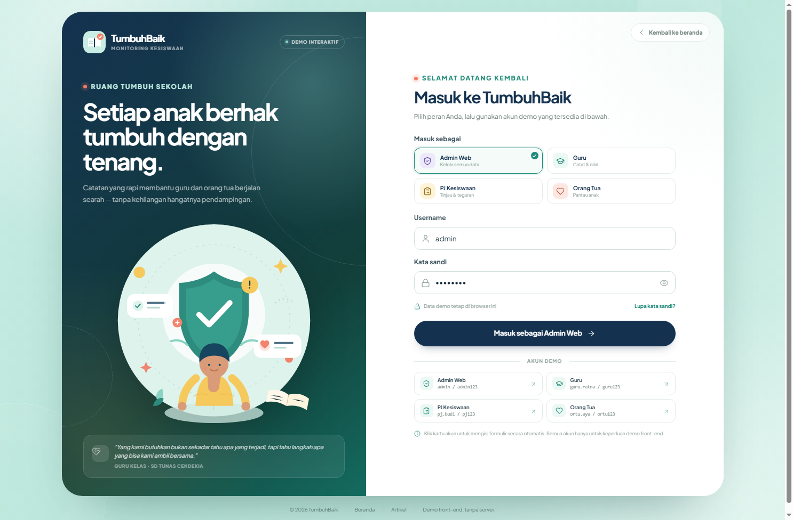

# TumbuhBaik

**Sistem Monitoring Pelanggaran Siswa SD** — demo front-end yang tenang, transparan, dan ramah anak. Tampilan terinspirasi dari tema *Active Academy Landing Page Template* di Dribbble, dengan ilustrasi, palet mint–navy–coral, serta komponen yang dibuat khusus untuk konteks kesiswaan sekolah dasar.

> Hanya HTML, CSS, JavaScript, dan Bootstrap 5 (Grid + Utilities) sebagai kerangka CSS. Tidak ada backend, framework JavaScript tambahan, atau proses build.

## Preview

| Landing | Dashboard Admin |
|---|---|
|  |  |

| Portal Orang Tua | Halaman Login |
|---|---|
|  |  |

Tampilan mobile: [navigasi mobile](preview/mobile-navigation.png).

---

## 1. Cara menjalankan

Paling mudah:

1. Buka `index.html` di browser modern (Chrome/Edge/Firefox).
2. Klik **Masuk ke dashboard** atau buka `login.html` langsung.

Jika browser membatasi penyimpanan lokal untuk file `file://`, jalankan server statis dari folder proyek:

```bash
python -m http.server 8000
```

Lalu buka:

```text
http://localhost:8000/index.html
```

Data demo disimpan di `localStorage` browser. Tidak ada data yang dikirim ke server.

---

## 2. Akun demo

| Peran | Username | Kata sandi | Catatan |
|---|---|---|---|
| Admin Web | `admin` | `admin123` | Akses penuh ke seluruh data dan pengaturan |
| Guru | `guru.ratna` | `guru123` | Wali kelas 3A & 4A, 8 siswa binaan |
| PJ Kesiswaan | `pj.budi` | `pj123` | Meninjau pelanggaran & menetapkan teguran |
| Orang Tua | `ortu.ayu` | `ortu123` | Terhubung dengan siswa **Maya Anggraini** (kelas 4A) |

Akun tambahan yang juga tersedia:

- Guru: `guru.hendra` / `guru123`, `guru.siti` / `guru123`, `guru.agus` / `guru123`
- PJ: `pj.rina` / `pj123`
- Orang tua: `ortu.nina` / `ortu123` (anak: Naufal Rizky)

Kartu akun demo di halaman login dapat diklik untuk mengisi formulir secara otomatis. Pilih peran terlebih dahulu; formulir akan terisi dengan akun demo peran tersebut.

---

## 3. Hak akses per peran

| Area | Admin Web | Guru | PJ Kesiswaan | Orang Tua |
|---|---|---|---|---|
| Ringkasan dashboard | ✅ semua siswa | ✅ siswa binaan | ✅ semua siswa | ✅ anak sendiri |
| Data siswa | ✅ CRUD | 👁️ siswa binaan | 👁️ semua siswa | — |
| Kelas / Guru / Akun PJ | ✅ CRUD | — | — | — |
| Pelanggaran | ✅ CRUD | ✅ catat & lihat siswa binaan | ✅ tinjau, edit, hapus | 👁️ anak sendiri |
| Jenis pelanggaran | ✅ CRUD | — | 👁️ referensi | — |
| Teguran & sanksi | ✅ CRUD | 👁️ siswa binaan | ✅ CRUD (hapus khusus admin) | 👁️ anak sendiri |
| Nilai & poin | ✅ edit nilai | ✅ edit nilai siswa binaan | 👁️ semua siswa | 👁️ anak sendiri |
| Artikel | ✅ CRUD | 👁️ | 👁️ | 👁️ |
| Web Assets | ✅ CRUD | — | — | — |
| Profil & kata sandi | ✅ | ✅ | ✅ | ✅ |

> “Hapus” pada teguran dibatasi ke Admin Web agar jejak pendampingan tetap terkontrol. PJ dapat membuat dan memperbarui teguran.

---

## 4. Fitur utama

- **Landing page responsif** dengan hero ilustrasi, fitur, peran, alur kerja, artikel dinamis dari database demo, dan CTA.
- **Login berbasis peran** dengan empat akun demo, validasi, tampilan kata sandi, dan banner sesi aktif.
- **Dashboard berbeda per peran**:
  - Admin: statistik, tren pelanggaran, pelanggaran terbanyak, catatan terbaru, ranking kelas.
  - Guru: hanya data kelas binaan, akses catat pelanggaran dan nilai.
  - PJ: peninjauan pelanggaran, pembuatan teguran, referensi jenis pelanggaran.
  - Orang tua: ringkasan anak, grafik poin, riwayat, teguran, nilai, dan artikel.
- **CRUD lengkap** untuk siswa, guru, kelas, PJ, jenis pelanggaran, pelanggaran, teguran, nilai, artikel, dan web assets.
- **Poin otomatis** — setiap pelanggaran dikaitkan ke jenisnya, lalu total poin siswa dihitung ulang dari base 100.
- **Filter & pencarian** di halaman data, serta pencarian global (`/` atau tombol Cari).
- **Modal form & detail**, toast notifikasi, konfirmasi hapus, dan penyimpanan lokal.
- **Reset data demo** dari halaman Profil (khusus Admin Web).
- **Responsif** diuji pada lebar desktop 1504 px, tablet, dan mobile 390 px tanpa horizontal overflow.

---

## 5. Struktur proyek

```text
monitoring-pelanggaran/
├── index.html                  # Landing page publik
├── login.html                  # Halaman masuk & akun demo
├── app.html                    # Shell dashboard SPA (hash router)
├── assets/
│   ├── css/
│   │   ├── base.css            # Design token, komponen dasar, modal, toast
│   │   ├── landing.css         # Tampilan landing page
│   │   ├── login.css           # Tampilan halaman login
│   │   └── app.css             # Tampilan dashboard
│   ├── js/
│   │   ├── data.js             # Seed ERD, localStorage, auth, relasi, statistik
│   │   ├── ui.js               # Ikon SVG, modal, toast, chart, helper UI
│   │   ├── landing.js          # Interaksi landing & artikel publik
│   │   ├── login.js            # Role picker & proses login
│   │   ├── app.js              # Shell, router, navigasi, pencarian global
│   │   ├── app-pages.js        # Halaman dashboard, siswa, guru, kelas, profil
│   │   └── app-records.js      # Pelanggaran, teguran, nilai, artikel, aset, PJ
│   └── img/
│       ├── logo-mark.svg
│       ├── favicon.svg
│       ├── hero-illustration.svg
│       ├── community-illustration.svg
│       └── login-illustration.svg
├── vendor/bootstrap/           # Bootstrap 5.3.3 Grid + Utilities (lokal)
├── preview/                    # Screenshot preview
└── README.md
```

---

## 6. Pemetaan ERD ke implementasi

Entity dan field bisnis mengikuti ERD yang diberikan. Data seed berada di `assets/js/data.js`.

### 6.1 Entitas

| Entitas ERD | Field | Implementasi |
|---|---|---|
| **Admin** | `id_admin`, `nama`, `username`, `password` | `db.admin`, mengelola seluruh data |
| **Web Assets** | `id_asset`, `nama_asset`, `file_url` | `db.webAssets`, halaman Web Assets |
| **Artikel** | `id_artikel`, `judul_artikel`, `isi_artikel`, `tanggal` | `db.artikel`, tampil di dashboard & landing |
| **Kelas** | `id_kelas`, `nama_kelas` | `db.kelas` |
| **Guru** | `id_guru`, `nama`, `username`, `password` | `db.guru` |
| **Siswa** | `id_siswa`, `nama`, `id_kelas` (FK), `id_guru` (FK) | `db.siswa`; `id_guru` diperlakukan sebagai wali kelas |
| **Nilai** | `id_nilai`, `id_siswa` (FK), `nilai_kompetensi`, `total_poin` | `db.nilai`; `total_poin` dihitung ulang otomatis |
| **Jenis_Pelanggaran** | `id_jenis`, `nama_pelanggaran`, `pengurangan_poin` | `db.jenisPelanggaran` |
| **Pelanggaran** | `id_pelanggaran`, `id_siswa` (FK), `id_jenis` (FK), `keterangan`, `tanggal` | `db.pelanggaran` |
| **Teguran** | `id_teguran`, `id_pelanggaran` (FK), `jumlah_teguran`, `catatan`, `sanksi` | `db.teguran` |
| **PJ** | `id_pj`, `nama`, `username`, `password` | `db.pj` |

### 6.2 Relasi yang dipakai

```text
Admin 1 ─── N semua entitas manajerial
Kelas 1 ─── N Siswa
Guru  1 ─── N Siswa        (siswa.id_guru → wali kelas)
Siswa 1 ─── 1 Nilai
Siswa 1 ─── N Pelanggaran
Jenis_Pelanggaran 1 ─── N Pelanggaran
Pelanggaran 1 ─── 0..1 Teguran
```

Beberapa penyesuaian yang disengaja dan didokumentasikan:

1. **Wali kelas** diturunkan dari `siswa.id_guru`, karena ERD `Kelas` hanya memiliki `id_kelas` dan `nama_kelas`. Wali yang tampil di kartu kelas adalah guru dengan siswa terbanyak di kelas tersebut.
2. **Tanggal teguran** tidak disimpan sebagai field baru (ERD tidak memilikinya); tanggal yang ditampilkan berasal dari `pelanggaran.tanggal`.
3. **Role Orang Tua** adalah lapisan akses tambahan, bukan entitas bisnis baru. Akun disimpan di `db.orangTua` dengan field akses `id_ortu`, `nama`, `username`, `password`, `id_siswa` agar orang tua hanya bisa melihat anaknya sendiri.
4. **Status tindak lanjut** tidak menjadi field baru. Status “sudah ditindaklanjuti” ditentukan dari ada/tidaknya baris `teguran` untuk `pelanggaran` tersebut.
5. **Poin perilaku** dihitung otomatis:

```text
total_poin = max(0, 100 − Σ pengurangan_poin dari seluruh pelanggaran siswa)
```

Poin dihitung ulang setiap kali pelanggaran atau jenis pelanggaran diubah/dihapus.

---

## 7. Teknologi & batasan

- HTML5 semantik.
- CSS murni dengan custom properties, grid/flex, animasi ringan.
- JavaScript klasik (tanpa module/bundler) agar mudah dibuka langsung.
- **Bootstrap 5.3.3 Grid + Utilities** disimpan lokal di `vendor/bootstrap/` dan digunakan sebagai kerangka CSS. Komponen khusus (modal, toast, chart) dibuat sendiri dengan JS agar tidak bergantung pada Bootstrap JS.
- Ikon berupa inline SVG (tanpa library ikon).
- Grafik berupa SVG yang digenerate JavaScript (tanpa Chart.js).
- Google Fonts (Plus Jakarta Sans) dimuat dari CDN; jika offline, font fallback sistem tetap dipakai.
- Data disimpan di:
  - `tumbuhbaik.db.v1` — database demo
  - `tumbuhbaik.session.v1` — sesi login

Reset data dapat dilakukan dari **Profil → Reset data demo** (Admin Web), atau dengan menghapus kedua key di atas dari Application → Local Storage.

---

## 8. Catatan desain

- Palet: mint `#D9F2EA`, navy `#143250`, teal `#1F8A79`, coral `#F47C63`, kuning `#F6C95D`.
- Tipografi: Plus Jakarta Sans.
- Sudut membulat besar, ilustrasi datar, dan ruang kosong yang lega untuk mengikuti nuansa referensi Dribbble.
- Referensi tema: [Active Academy Landing Page Template](https://dribbble.com/shots/12027742-active-academy-landing-page-template).
- Semua ilustrasi dan komponen adalah aset orisinal untuk demo ini, bukan salinan dari template referensi.

---

## 9. Alur uji cepat

1. Buka `login.html` → pilih **Admin Web** → masuk.
2. Buka **Data Siswa** → tambah siswa → buka detailnya.
3. Buka **Pelanggaran** → catat pelanggaran untuk siswa tersebut.
4. Sebagai **PJ Kesiswaan**, buka pelanggaran pending → buat teguran.
5. Login sebagai **Orang Tua** → lihat ringkasan Maya → buka pelanggaran, teguran, dan nilai.
6. Dari **Profil Admin**, ubah kata sandi atau reset data demo.

Selamat mencoba. 🌱
